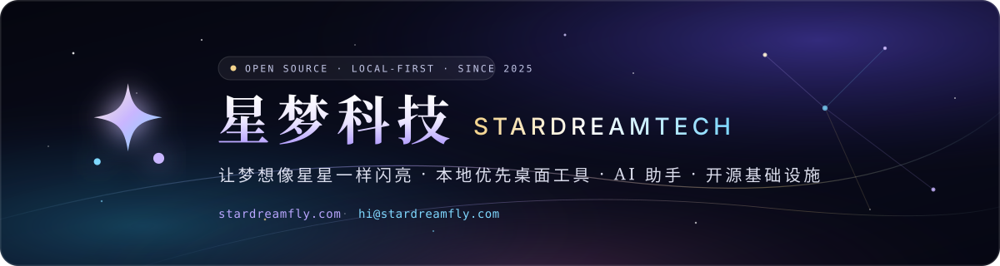

<div align="center">

<a href="https://stardreamfly.com/" target="_blank">
  <picture>
    <source media="(prefers-color-scheme: dark)" srcset="./banner-dark.svg" />
    <source media="(prefers-color-scheme: light)" srcset="./banner-light.svg" />
    
  </picture>
</a>

<br />

<p>
  <a href="https://stardreamfly.com/"></a>
  <a href="https://stardreamfly.com/projects/starlock/demo/"></a>
  <a href="https://github.com/StarDreamTech/homebrew-tap"></a>
  <a href="mailto:hi@stardreamfly.com"></a>
</p>

<p>
  专注 <strong>本地优先（Local-first）</strong> 桌面工具、AI 对话档案与智能体、网页监控与人机验证基础设施。<br />
  把已发布应用与正在演进的想法放在同一片星图里，真实展示进度，欢迎试用、提 Issue 与参与贡献。
</p>

</div>

---

## ✨ 已发布 · 开箱即用

| 产品 | 定位 | 最新版本 | 技术栈 & 平台 | 快速入口 |
| :--- | :--- | :---: | :--- | :--- |
| **星笺 [StarClip](https://github.com/StarDreamTech/StarClip)** | 本地优先剪贴板管理器，含星码集与星绘坊卡片 | `v0.2.7` | Rust · Tauri 2 · SQLite · macOS / Win | [介绍页](https://stardreamfly.com/projects/starclip/) · [下载](https://github.com/StarDreamTech/StarClip/releases/latest) |
| **星镜 [StarShot](https://github.com/StarDreamTech/StarShot)** | 桌面截图、标注、置顶贴图与本地敏感信息打码 | `v0.3.3` | Rust · Tauri 2 · Vue 3 · macOS / Win | [介绍页](https://stardreamfly.com/projects/starshot/) · [下载](https://github.com/StarDreamTech/StarShot/releases/latest) |
| **星匣 [StarVault](https://github.com/StarDreamTech/StarVault)** | AI 对话增量档案、附件与 Skill 迁移（桌面端 / CLI / MCP） | `v0.1.4` | Python · macOS / Linux CLI | [介绍页](https://stardreamfly.com/projects/starvault/) · [下载](https://github.com/StarDreamTech/StarVault/releases/latest) |

### 🍺 一行命令安装（Apple Silicon Mac）

```bash
# 星笺 · 剪贴板管理器
brew install --cask stardreamtech/tap/starclip

# 星镜 · 截图 / 标注 / 贴图
brew install --cask stardreamtech/tap/starshot

# 星匣 · AI 对话档案（桌面端 / 仅 CLI & MCP）
brew install --cask stardreamtech/tap/starvault
brew install stardreamtech/tap/starvault
```

> Windows 安装包与校验和（`SHA256SUMS`）请在各项目 Release 页面获取。

---

## 🛠️ 开发中 · 已有代码实现

| 项目 | 说明 | 当前状态 | 入口 |
| :--- | :--- | :---: | :--- |
| **星锁 [StarLock](https://github.com/StarDreamTech/StarLock)** | 开源人机验证 SDK 与 FastAPI 服务（8 种题型，Vue / React + Python / Go SDK） | `v0.8.0 开发版` | [在线试玩](https://stardreamfly.com/projects/starlock/demo/) · [介绍页](https://stardreamfly.com/projects/starlock/) |
| **星哨 [StarWatch](https://github.com/StarDreamTech/StarWatch)** | 可自托管的网页与接口定时监控平台，支持历史内容逐行 Diff | `开发中` | [介绍页](https://stardreamfly.com/projects/starwatch/) |
| **星使 [StarEnvoy](https://github.com/StarDreamTech/StarEnvoy)** | 按条件筛选 BOSS 岗位并集中管理结果与沟通记录（PySide6） | `源码阶段` | [介绍页](https://stardreamfly.com/projects/starenvoy/) |
| **星口 [StarPort](https://github.com/StarDreamTech/StarPort)** | 从本机 Clash 配置按节点分配独立 SOCKS 端口并页面化启停（Go · mihomo） | `原型阶段` | [介绍页](https://stardreamfly.com/projects/starport/) |

---

## 🌱 筹备与孵化中

- **星码 [starcode](https://github.com/StarDreamTech/starcode)** — 基于 OpenCode 改造的开源 AI Agent 客户端（[介绍](https://stardreamfly.com/projects/starcode/)）
- **星搭子 [StarBuddy](https://github.com/StarDreamTech/StarBuddy)** — 围绕原创角色「星芽」构建的个人电脑助手（[介绍](https://stardreamfly.com/projects/starbuddy/)）
- **星相 [StarPersona](https://github.com/StarDreamTech/StarPersona)** — 规划中的开源指纹浏览器与多账号环境管理（[介绍](https://stardreamfly.com/projects/starpersona/)）
- **星盘 [StarDash](https://github.com/StarDreamTech/StarDash)** — 规划中的跨平台菜单栏与托盘状态面板（[介绍](https://stardreamfly.com/projects/stardash/)）

---

## 🤝 定制服务 & 联系我们

除了开源项目，我们也承接小而精的定制开发，先交付最小可用版本、再按需迭代：

- **定制 Agent**：把你的工具、文档与接口接入可控边界的智能体（支持本地或私有部署）
- **定制官网**：为个人、工作室或开源项目打造明暗双色、移动端友好的品牌主页
- **定制软件**：桌面工具、CLI 或轻量 Web 应用，数据可完全保留在自有设备

📬 **合作与咨询邮箱**：[hi@stardreamfly.com](mailto:hi@stardreamfly.com)  
🌐 **完整星图与服务说明**：[stardreamfly.com](https://stardreamfly.com/) · [AI 文档索引 (`llms.txt`)](https://stardreamfly.com/llms.txt) · [作者主页](https://cpython666.github.io)
